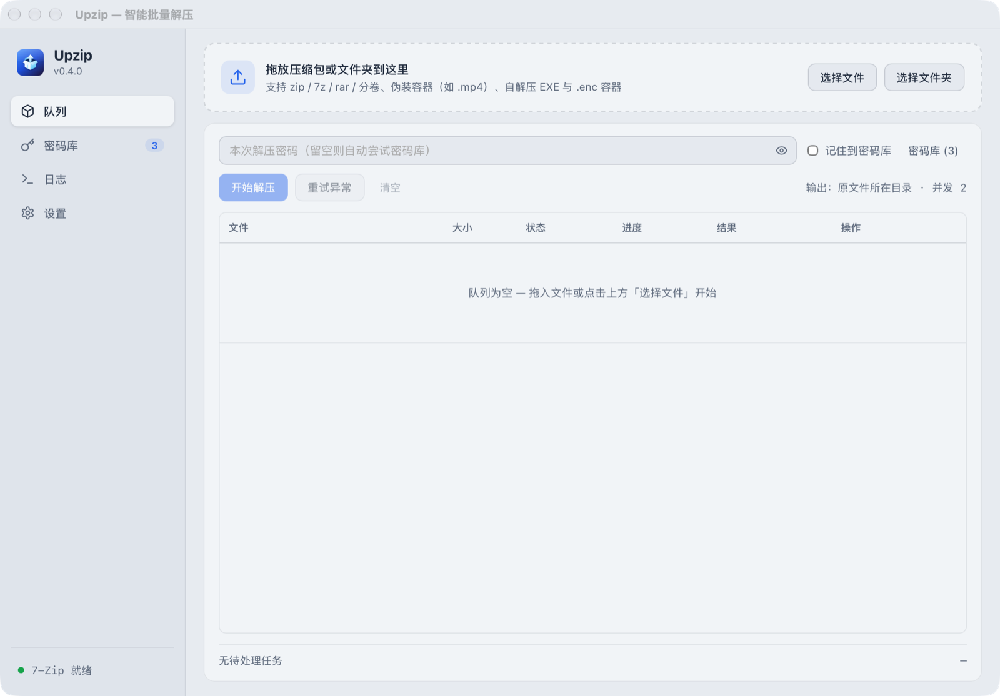

# Upzip

把文件拖进窗口，剩下的它来：认格式、试密码、把嵌套的压缩包一层层解开。
macOS 和 Windows 都有，界面是 Tauri，解包内核是 Rust。



## 下载

到 [Releases](https://github.com/carrotluo5/upzip-desktop/releases) 选对应系统：

| 系统 | 文件 |
|---|---|
| macOS（Apple Silicon） | `Upzip-0.4.0-macos-arm64.dmg` |
| Windows x64（免安装） | `Upzip-0.4.0-win-x64-portable.zip` |
| 校验 | `SHA256SUMS.txt` |

macOS 版没签名也没公证，第一次打开会被拦，右键点应用选「打开」就行。
Windows 版解压出来直接双击 `Upzip.exe`，不用安装（Windows 10 要装 WebView2 Runtime，
Windows 11 自带）；包里还有 `upzip-cli.exe` 是命令行版。两个 exe 都内嵌了 7-Zip 25.01，
首次运行会在 `%LOCALAPPDATA%\Upzip` 缓存一份 7-Zip。

## 能解什么

- Paranoia File Encryption v4（SSEFE）加密文件。解出来的内容如果还是压缩包，接着解
- 普通压缩包：zip / 7z / rar / tar / gz / xz / bz2 / cab / iso，以及 7-Zip 支持的其他格式
- 分卷：`.7z.001`、`.zip.001`、`.part1.rar`；`.enc` 分卷会自动归成一个任务
- 伪装过的包：比如 mp4 头后面接一段 zip，或者开头带垃圾数据的 zip
- 自解压 EXE：只解包，不运行
- 嵌套压缩包默认解 4 层，每一层可以有不同的密码

不做：加密、Paranoia v3、PFTEREC1 恢复容器、联网、自动更新。

## 用法

拖文件或文件夹进窗口 → 输密码（可以勾「记住到密码库」）→ 开始解压。
队列里能暂停、取消、重试失败的项；左边「密码库」管密码，「设置」里换主题、开「跳过已处理」。
遇到问题时，日志在配置目录的 `logs/upzip.log`，设置页的「诊断信息」能直接复制。

### 命令行

Windows 便携包自带 `upzip-cli.exe`；macOS 上要自己编译：

```bash
cargo build --release -p upzip-cli
target/release/upzip-cli --help
```

常用命令：

```bash
upzip-cli doctor                                 # 检查 7-Zip 和配置目录
upzip-cli detect 文件.enc                         # 只识别，不写盘
upzip-cli inspect 文件.enc                        # 打印加密头（版本、KDF 参数、salt）
upzip-cli run 文件.enc -p 密码 -o 输出目录         # 解密并解内层
upzip-cli run 一批文件 -p 密码 -j 4 --json         # 批量，JSON 输出
upzip-cli run 3138.7z.001.enc 3138.7z.002.enc     # 分卷自动合并处理
upzip-cli config --add-password 密码               # 加进密码库
upzip-cli cleanup-staging --root ~/Downloads      # 清理中断留下的临时目录
```

`-p` 可以给多次。没给密码时依次试环境变量 `UPZIP_PASSWORD`（旧名 `PARANOIA_ENC_PASSWORD` 也认）、
密码库、压缩包注释里的提示、空密码（要加 `--try-empty-password`）。
退出码：0 成功，1 有失败或缺密码，2 用法或环境错误，130 被 Ctrl-C 打断。

## 数据在哪

| 系统 | 目录 |
|---|---|
| macOS | `~/Library/Application Support/upzip/` |
| Windows | `%APPDATA%\upzip\` |

`config.json` 是密码库（明文，Unix 上权限 0600），`settings.json` 是设置，`logs/upzip.log`
是日志（超过 2 MiB 转成 `.1`）。想换位置就设 `UPZIP_CONFIG_DIR`。

密码库是明文存的，不是保险箱。共享电脑上别放重要密码。

## 从源码构建

要 Rust、Node 22+、pnpm 11。

```bash
./scripts/build.sh                    # macOS：测试 + 前端 + 打包 app 和 dmg
./scripts/build-windows-portable.sh   # 在 macOS 上交叉编译 Windows 便携 zip
```

在真 Windows 上打包安装程序用 `.\scripts\build-windows.ps1`（这条路没验证过）。
改前端时用 `pnpm --dir gui tauri dev`。

依赖、产物和签名细节见 [docs/BUILD.md](docs/BUILD.md) 与 [docs/WINDOWS_BUILD.md](docs/WINDOWS_BUILD.md)。

## 说明

- macOS 包只有 Apple Silicon，未签名未公证；Windows 包是在 macOS 上交叉编译的，还没在真 Windows 上跑过。两个平台都没做代码签名。
- 只解密和解包，不加密；Paranoia 只支持 v4。
- 解出来的文件不会被执行。7-Zip 是子进程调用，恶意压缩包的风险由 7-Zip 承担，记得保持更新。
- 密码通过命令行参数传给 7z 子进程，同机其他进程理论上能从进程表看到。
- v0.4.0 把名字从 Unparanoia（帕罗诺亚解包器）改成了 Upzip。旧配置目录和密码库会自动读取，不用手动搬。

## 文档

- [docs/FORMAT.md](docs/FORMAT.md) — Paranoia v4 文件格式和 KDF
- [docs/OUTPUT-LAYOUT.md](docs/OUTPUT-LAYOUT.md) — 输出目录、冲突处理、临时文件和失败行为
- [docs/CORE_API.md](docs/CORE_API.md) — Rust core API
- [docs/VERIFICATION.md](docs/VERIFICATION.md) — 测试和验证记录，包括没验证的部分
- [docs/MERGE-MAPPING.md](docs/MERGE-MAPPING.md)、[docs/DEV-CONTRACT.md](docs/DEV-CONTRACT.md) — 历史文档

## 许可证

代码是 MIT，见 [LICENSE](LICENSE)。随附的 7-Zip 25.01 是 LGPL v2.1+，见 [NOTICE](NOTICE)。
